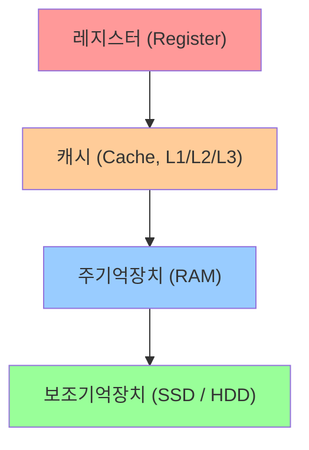

# RAM (Random Access Memory)

작성자: 2022113377 하영모

## 목차

- [개요](#개요)
- [메모리 계층 구조](#메모리-계층-구조)
- [RAM의 종류](#ram의-종류)
  - [SRAM (Static RAM)](#sram-static-ram)
  - [DRAM (Dynamic RAM)](#dram-dynamic-ram)
- [ECC RAM (오류 수정 기능)](#ecc-ram-오류-수정-기능)
- [DDR SDRAM의 세대](#ddr-sdram의-세대)
- [RAM 타이밍 — CAS Latency(CL)](#ram-타이밍--cas-latencycl)
- [선택 가이드](#선택-가이드)
- [용어 정리 (Glossary)](#용어-정리-glossary)
- [요약](#요약)

## 개요

RAM(Random Access Memory)은 CPU가 사용 중인 프로그램 코드와 데이터를 저장하는 주기억장치로, 저장 위치와 상관없이 일정한 시간 안에 접근할 수 있어 "Random Access"라는 이름이 붙었습니다. 전원이 꺼지면 내용이 사라지는 휘발성(volatile) 메모리라는 점에서, 전원이 꺼져도 데이터가 유지되는 SSD/HDD 같은 보조기억장치와는 역할이 다릅니다.


## 메모리 계층 구조

컴퓨터의 메모리는 속도·용량·가격에 따라 계층 구조를 이루며, RAM은 캐시와 보조기억장치 사이의 중간 역할을 담당합니다.



위로 갈수록 속도가 빠르고 용량이 작으며 가격이 비쌉니다.

## RAM의 종류

### SRAM (Static RAM)

플립플롭(flip-flop) 회로로 데이터를 저장해 리프레시 없이도 보존되며 속도가 매우 빠릅니다. 셀 하나에 트랜지스터가 6개 필요해 집적도가 낮고 비싸므로, 주로 CPU 캐시 메모리(L1~L3)에 사용됩니다.

### DRAM (Dynamic RAM)

커패시터(capacitor)에 전하를 충전해 데이터를 저장하며, 전하가 자연 방전되므로 주기적인 리프레시(refresh)가 필요합니다. SRAM보다 느리지만 셀 구조가 단순(트랜지스터 1개+커패시터 1개)해 저렴하고 집적도가 높아, 일반 PC의 메인 메모리로 사용됩니다.

| 구분 | SRAM | DRAM |
|------|------|------|
| 저장 방식 | 플립플롭 | 커패시터 |
| 리프레시 | 불필요 | 필요 |
| 속도 | 빠름 | 상대적으로 느림 |
| 집적도 | 낮음 | 높음 |
| 가격 | 비쌈 | 저렴 |
| 주요 용도 | CPU 캐시 | PC 주기억장치 |

## ECC RAM (오류 수정 기능)

RAM은 우주선(cosmic ray)이나 전자기 노이즈 등의 영향으로 아주 드물게 비트가 저절로 뒤집히는 소프트 에러(soft error)가 발생할 수 있습니다. ECC(Error Correcting Code) RAM은 각 데이터 블록에 패리티(parity) 비트를 추가해 이런 오류를 하드웨어 수준에서 자동으로 감지·수정하는 메모리입니다. 흔히 쓰이는 SECDED 방식은 1비트 오류는 복구하고 2비트 오류는 감지만 합니다. 패리티 저장을 위해 칩이 하나 더 필요해(예: 8개→9개) 용량과 비용이 늘고 약간의 지연도 생기므로, 일반 PC보다는 오류 하나도 치명적인 서버·워크스테이션 환경에 주로 사용됩니다. 단, CPU와 메인보드도 ECC를 지원해야 실제로 동작합니다.

## DDR SDRAM의 세대

현재 PC는 대부분 DDR SDRAM(Double Data Rate) 계열을 사용하며, 클럭의 상승/하강 엣지를 모두 써서 SDR 대비 2배의 전송률을 냅니다.

- **DDR4**: 2014년부터 보급, 동작 전압 1.2V, 대역폭 최대 25.6GB/s(DDR4-3200 기준)
- **DDR5**: 2021년부터 보급, 동작 전압 1.1V, 대역폭 약 2배 향상, PMIC 내장으로 더 안정적인 전원 공급

핀 수와 노치 위치가 달라 DDR4·DDR5는 서로 호환되지 않으므로, 메인보드 지원 규격을 반드시 확인해야 합니다.

## RAM 타이밍 — CAS Latency(CL)

클럭 속도만으로는 체감 속도를 다 설명할 수 없어, 읽기 명령 후 데이터가 나오기까지 걸리는 지연인 **CAS Latency(CL)**(클럭 사이클 수 기준, 작을수록 빠름)도 함께 봐야 합니다.

```
실제 지연시간(ns) = CL ÷ 실제 클럭(MHz) × 1000
```

예를 들어 "DDR4-3200 CL16"은 실제 클럭이 전송률의 절반(1600MHz)이므로 `16 ÷ 1600 × 1000 = 10ns`입니다. 클럭이 높아도 CL이 같이 커지면 체감 차이가 거의 없으므로, 구매 시 전송률과 CL을 함께 비교해야 합니다.

## 선택 가이드

RAM 구매 시 고려해야 할 핵심 항목은 다음과 같습니다.

- **용량**: 일반 사무·웹 브라우징 8GB, 게임·개발 16GB, 영상 편집·고사양 작업 32GB 이상 권장
- **규격(DDR 세대)**: 메인보드가 지원하는 세대(DDR4 / DDR5)와 일치해야 함
- **클럭 속도와 CL**: 클럭은 높을수록 유리하지만 CL도 함께 낮아야 실제 지연시간이 줄어듦 — 위 공식으로 환산해서 비교 권장
- **채널 구성**: 싱글 채널보다 듀얼 채널(같은 용량의 모듈 2개 장착)이 대역폭을 약 2배 높여 성능 향상에 도움이 됨
- **발열**: 고클럭 RAM에는 방열판(히트스프레더)이 달려 있어 안정성을 높이지만, 대형 CPU 쿨러와 간섭이 생길 수 있으므로 케이스 내부 공간 확인 필요

## 용어 정리 (Glossary)

- **휘발성(Volatile)**: 전원이 꺼지면 저장된 데이터가 모두 사라지는 특성. RAM은 휘발성 메모리이고, SSD/HDD는 비휘발성(Non-volatile) 메모리입니다.
- **리프레시(Refresh)**: DRAM의 커패시터가 전하를 잃기 전에 주기적으로 데이터를 다시 써주는 동작. 구조상 커패시터를 쓰지 않는 SRAM에는 필요 없습니다.
- **대역폭(Bandwidth)**: 단위 시간당 전송할 수 있는 데이터 양(보통 GB/s). 클럭 속도와 채널 수에 영향을 받습니다.
- **클럭(Clock)**: 메모리가 데이터를 주고받는 속도의 기준이 되는 신호 주파수. DDR는 클럭의 상승/하강 엣지를 모두 사용해 전송률을 2배로 높입니다.
- **CAS Latency(CL)**: 읽기 명령 후 실제 데이터가 출력되기까지 걸리는 지연 시간(클럭 사이클 수 기준).
- **패리티(Parity)**: 오류 검출·수정을 위해 원본 데이터에 추가로 붙이는 비트. ECC RAM이 이를 이용해 비트 오류를 찾아냅니다.
- **DIMM(Dual In-line Memory Module)**: 메인보드 슬롯에 꽂아 쓰는 일반적인 RAM 모듈의 규격.
- **채널(Channel)**: CPU와 메모리 사이의 데이터 통로 개수. 듀얼 채널은 싱글 채널보다 대역폭이 약 2배 늘어납니다.
- **PMIC(Power Management IC)**: DDR5 모듈 내부에 내장된 전력 관리 회로로, 메인보드 대신 모듈 자체에서 전압을 안정적으로 공급합니다.

## 요약

- RAM은 CPU가 작업 중인 데이터를 임시로 올려두는 **휘발성 주기억장치**로, 전원이 꺼지면 내용이 사라지며 메모리 계층에서 캐시보다 느리지만 보조기억장치보다 훨씬 빠른 중간 지점에 위치합니다.
- 구조상 크게 **SRAM**(빠르지만 비싸고 캐시용)과 **DRAM**(느리지만 저렴하고 주기억장치용)으로 나뉘며, 신뢰성이 중요한 서버·워크스테이션에는 비트 오류를 자동 수정하는 **ECC RAM**이 추가로 쓰입니다.
- 일반 PC에서 실제로 사용하는 RAM은 **DDR4/DDR5 SDRAM** 계열이며, 세대가 올라갈수록 동작 전압은 낮아지고 대역폭은 늘어나지만 서로 호환되지 않습니다.
- 체감 속도는 클럭(전송률)만으로 정해지지 않고 **CAS Latency(CL)**까지 함께 고려해야 하며, 실제 지연시간은 `CL ÷ 실제 클럭(MHz) × 1000`(ns)으로 계산합니다.
- 구매 시에는 **용량·DDR 세대·클럭/CL·듀얼채널 여부·발열(방열판)**을 함께 따져봐야 체감 성능과 호환성을 모두 만족시킬 수 있습니다.
